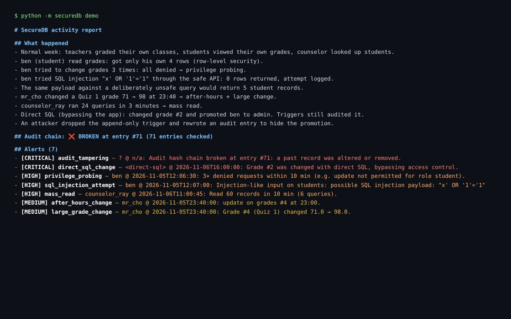

# 🔐 SecureDB — database security project

SecureDB is a small school-records database (students, classes, grades) with security built into the database: role-based permissions, row-level security, a **tamper-evident audit log**, SQL-injection-safe access, and rules that detect suspicious activity.



## My role & contributions

**Solo developer · AI-assisted**

- Designed the school-records schema, roles, and row-level access rules
- Planned the misuse scenarios (privilege probing, SQL injection, mass reads, tampering) and checked each is detected
- Used database triggers plus a hash chain so even direct-SQL edits are recorded and tampering is provable

**Languages:** SQL (SQLite schema, constraints, triggers) · Python (access layer, detection)
**Shows:** database design, secure software development, least privilege, auditing, and detection engineering.

## Quick start
```bash
python -m securedb demo           # scripted week with misuse → report with 7 alerts
python -m securedb demo --clean   # same week with no misuse → 0 alerts
python -m pytest -q               # 9 tests
```

## Security controls
| Control | How it works |
|---|---|
| **Role-based permissions** | `permissions(role, resource, action, scope)` table: admin, teacher, counselor, student. Checked on every call in `access.py`. |
| **Row-level security** | Scopes: `all`, `class` (teachers see only students and grades in classes they teach), `own` (students see only their own rows). Added as SQL `WHERE` clauses. |
| **SQL injection defense** | All values are bound parameters. Table and column names come only from whitelists, never from user input. Injection-like input is still *logged*, because the attempt itself matters. `unsafe_lookup()` shows the vulnerable pattern for comparison (the same payload leaks every student). |
| **Integrity constraints** | `CHECK (score BETWEEN 0 AND 100)`, grade level 9–12, and a composite foreign key so a grade can only exist for an enrolled student. |
| **Audit logging in the database** | Triggers on `grades`, `students`, and `users` write to `audit_log` automatically, so even changes made with the raw `sqlite3` shell are recorded (as `<direct-sql>`). |
| **Append-only, hash-chained audit** | Triggers block `UPDATE`/`DELETE` on `audit_log`. Every entry stores `sha256(previous hash + entry)`. If someone drops the trigger and edits history, `verify` finds the exact entry where the chain breaks. |
| **Least privilege for admins** | Nobody can change their own role. Role changes are audited. |

## Detection rules (`detect.py`)
| Rule | Signal | Severity |
|---|---|---|
| `audit_tampering` | hash chain broken | critical |
| `direct_sql_change` | grade changed outside the access layer | critical |
| `privilege_escalation` | anyone promoted to admin | high / critical |
| `privilege_probing` | 3+ denied requests in 10 min | high |
| `sql_injection_attempt` | injection patterns in input | high |
| `mass_read` | 50+ records read in 10 min | high |
| `after_hours_change` | data changed outside 07:00–19:00 | medium |
| `large_grade_change` | a score moved by 15+ points | medium |

The demo injects each of these and all are detected. The clean week produces none. See `docs/sample_report.md`.

## Files
`securedb/schema.sql` (tables, constraints, triggers) · `db.py` (connection, hash chain, seed data) · `access.py` (permission-checked API) · `detect.py` · `demo.py` · `tests/`

## License

**Permission required.** © 2026 Dagmawi Melaku. You need my written permission before using, copying, or modifying this code, and any approved use must credit me with a link to this repository. Viewing, forking on GitHub, and running it to judge or review a submission are allowed without asking. To ask, [open an issue](../../issues/new). See [LICENSE](LICENSE) for the full terms.
